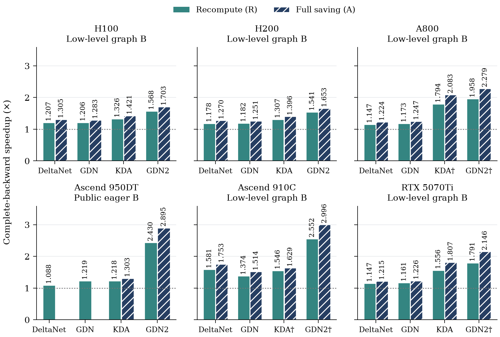

# ReWY: Faster Gradient Computation for Delta-Rule Attention Family

ReWY accelerates the backward pass of **DeltaNet, Gated DeltaNet (GDN),
Kimi Delta Attention (KDA), and GDN2** without changing the model recurrence or
training objective. This repository provides the paper's operator implementations,
FLA integrations, tests, and experiment reproduction tools, with NVIDIA GPU
support and experimental Huawei Ascend NPU paths.

[](pyproject.toml)
[](docs/compatibility.md)
[](docs/compatibility.md)
[](LICENSE)

**[Quick Start](#quick-start)** · **[Performance](#performance)** · **[Reproduce](#reproduce)** · **[Documentation](docs/README.md)** · **[中文](README.zh-CN.md)**

The method simplifies backward computation before kernel optimization:

- **Residual WY** reduces local WY matrix products from seven to three.
- **Matrix Intra** expresses KDA/GDN2 vector-gated interactions as matrix contractions.
- **Gram Elimination** removes a redundant key Gram matrix in GDN.

These transformations preserve the recurrence and gradients **in exact arithmetic**;
floating-point implementations are checked numerically. See the
[architecture guide](docs/architecture.md) for the method and kernel design.

## Quick Start

### Install

For NVIDIA CUDA, use Linux, Python 3.11+, and a compatible NVIDIA driver.
The installer pins the FLA revision and matching dependencies. For Ascend or an
existing environment, see the [installation guide](docs/installation.md).

```bash
git clone https://github.com/flashserve/ReWY.git
cd ReWY
python3 -m venv .venv
source .venv/bin/activate
bash scripts/install.sh cuda
fdr verify --device cuda
```

### Existing Training Scripts

```bash
fdr run --backend original train.py --config config.yaml
fdr run --backend optimized --report results/dispatch.json \
  train.py --config config.yaml
```

Or run the included CUDA KDA example:

```bash
fdr run --backend optimized examples/train_step.py --steps 2
```

The dispatch report records which optimized backward operators ran. Unsupported
configurations fail by default; `--fallback original` explicitly allows a reported
fallback. Runs with no optimized backward are rejected unless
`--allow-no-backward` is set for a forward-only task.

### Python

```python
import fast_delta_rule as fdr
fdr.enable("optimized")  # Before importing FLA or model modules

from fla.ops.kda import chunk_kda
```

Direct operator calls, scoped backend selection, and optional Qwen3.5/GDN2
adapters are documented in the [usage guide](docs/usage.md). Direct calls use the
original backend unless optimization is enabled or an optimized scope is active.
Model adapters replace only the delta-rule core, not the complete model.

## Performance

Selected **precision-qualified** results using full saving, reported as
six-shape geometric means against matched frozen baselines:

| Hardware | Operator | Backward Speedup | Timing Scope |
| --- | --- | ---: | --- |
| NVIDIA RTX 5070 Ti Laptop | KDA | **1.81×** | Complete low-level backward |
| NVIDIA A800 | GDN | **1.25×** | Complete low-level backward |
| Ascend 910C (`Ascend910_9382`) | GDN | **1.51×** | Complete low-level backward |
| NVIDIA H100 80GB HBM3 | GDN2 | **1.70×** | Complete low-level backward |
| NVIDIA H200 | GDN2 | **1.65×** | Complete low-level backward |
| Ascend950DT_9582 | GDN2 | **2.89×** | Public-autograd backward (experimental) |

The first five devices use warmed device-graph timing; Ascend950 uses synchronized
eager public autograd. Different timing boundaries are not pooled. **These are
operator-backward gains, not full training speedups.**



**†** marks historical controls that lowered existing FP32 intermediate precision;
these are excluded from the table above. Timing definitions, full-model backward
results and their limitations, memory reductions, and component ablations are in
the [results guide](docs/results.md).

## Compatibility

| Platform | Status |
| --- | --- |
| NVIDIA CUDA | Public-library validation on A800-SXM4-80GB; other GPUs require separate checks |
| Ascend910_9382 | Experimental Triton-Ascend path |
| Ascend950DT_9582 | Experimental path with device-specific setup |

The public API supports **BF16 q/k/v**, equal head counts, `K = V = 128`,
**64-token chunks**, and fixed-length sequences divisible by 64. KDA/GDN2 support
native recomputation and full saving; GDN/DeltaNet retain upstream saving semantics.

Packed/variable-length sequences, higher-order gradients, full-graph
`torch.compile`, distributed training, and full-model convergence are **not
release-validated**. Ascend requires matching CANN/`torch_npu`/Triton-Ascend and
`FDR_EXPERIMENTAL_NPU=1`. See [compatibility](docs/compatibility.md) for the full
supported input and precision requirements.

## Reproduce

### Paper Experiments

Published Docker images preserve the corresponding experiment environments.
For example, on a Linux host with an idle A800 and NVIDIA Container Toolkit:

```bash
python scripts/reproduce_paper.py a800 --device 0 --output results/paper-a800
```

See the [Docker guide](containers/README.md) for A800/Ascend9382 image versions,
device setup, output files, and resuming runs; use the
[H100/H200 guide](containers/hopper-statefix/README.zh-CN.md) or
[Ascend950 protocol](docs/ascend950.zh-CN.md) for those devices.

### Benchmark Your Workload

```bash
fdr benchmark --op kda --device cuda --boundary B --policy recompute
fdr reproduce --suite release --device cuda --output results/run-001
```

These commands use **synchronized eager public autograd**, which differs from
historical low-level paper timing. `B` measures backward; `FB` measures forward
and backward. Neither is a full training step. See the
[reproduction guide](docs/reproduction.md) for protocols and correctness checks.

### Render Figures on CPU

```bash
python -m pip install -r benchmarks/requirements.txt
python benchmarks/plotting/make_figures.py --output-dir results/paper-figures
```

This renders the six figures from checked-in aggregates, not new hardware
measurements. See [benchmarks and data](benchmarks/README.md) for figure inputs
and algebra checks.

## Documentation

- [Installation](docs/installation.md) and [usage](docs/usage.md)
- [Compatibility](docs/compatibility.md) and [validation](docs/validation.md)
- [Results](docs/results.md) and [reproduction protocols](docs/reproduction.md)
- [Experiment source map](research/README.md) and [repository layout](docs/repository.md)

## Contributing

Issues, kernel improvements, hardware ports, and reproducible benchmarks are
welcome. Include hardware, software versions, input shapes, precision, save
policy, and timing boundary when reporting performance. See the
[contribution guide](CONTRIBUTING.md).

## Citation

```bibtex
@misc{zhang2026fasterdelta,
  title  = {ReWY: Faster Gradient Computation for Delta-Rule Attention Family},
  author = {Yi Zhang and Zhixin Zhao and Weiwei Sun and Yitao Hu and Sheng Chen and Keqiu Li},
  year   = {2026},
  url    = {https://github.com/flashserve/ReWY},
  note   = {Manuscript and reproducibility artifact}
}
```

## License

[MIT](LICENSE). Adapted FLA code retains its original notices; see [Third-Party Notices](THIRD_PARTY_NOTICES.md).
Machine-readable citation metadata is available in [CITATION.cff](CITATION.cff).
