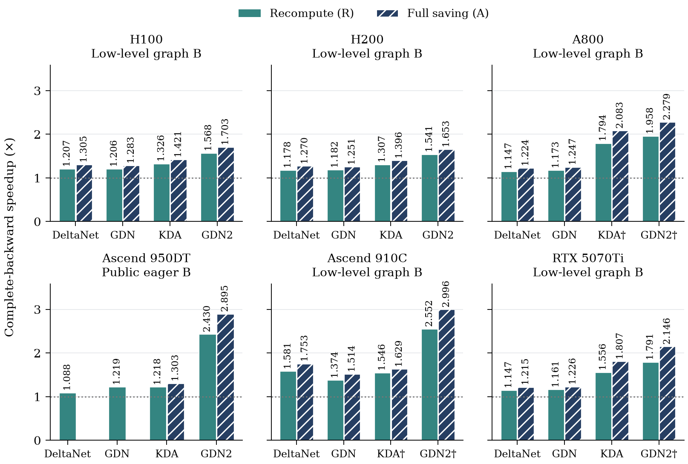

# ReWY: Faster Backpropagation for Delta-Rule Attention — From 7 to 3 Matrix Multiplications

ReWY 在不改变模型递推和训练目标的前提下，加速 **DeltaNet、Gated DeltaNet（GDN）、
Kimi Delta Attention（KDA）和 GDN2** 的反向计算。本仓库提供论文的算子实现、
FLA 接入、测试和实验复现工具，支持 NVIDIA GPU，并提供实验性 Huawei Ascend NPU 路径。

[](pyproject.toml)
[](docs/compatibility.md)
[](docs/compatibility.md)
[](LICENSE)

[快速开始](#快速开始) · [实验结果](#实验结果) · [复现实验](#复现实验) · [文档](docs/README.md) · [English](README.md)

ReWY 先简化反向计算，再优化内核：

- **Residual WY** 将局部 WY 矩阵乘法从七次减为三次。
- **Matrix Intra** 将 KDA/GDN2 的向量门控交互改写为矩阵乘法。
- **Gram Elimination** 消除 GDN 中冗余的 key Gram 矩阵。

这些变换在**精确算术下**保持递推与梯度，浮点实现通过数值检查验证。
方法和内核设计见[架构说明](docs/architecture.md)。

## 快速开始

### 安装

NVIDIA CUDA 版本需要 Linux、Python 3.11+ 和兼容的 NVIDIA 驱动。
安装脚本固定 FLA 版本及匹配的依赖。Ascend 或已有环境的安装方式见[安装说明](docs/installation.md)。

```bash
git clone https://github.com/flashserve/ReWY.git
cd ReWY
python3 -m venv .venv
source .venv/bin/activate
bash scripts/install.sh cuda
fdr verify --device cuda
```

### 接入训练脚本

```bash
fdr run --backend original train.py --config config.yaml
fdr run --backend optimized --report results/dispatch.json \
  train.py --config config.yaml
```

也可以运行仓库提供的小型 CUDA KDA 示例：

```bash
fdr run --backend optimized examples/train_step.py --steps 2
```

报告记录实际执行的优化反向算子。不支持的配置默认报错；
`--fallback original` 显式允许回退，并记录原因。没有执行优化反向的运行会报错，
仅前向任务可显式设置 `--allow-no-backward`。

### Python

```python
import fast_delta_rule as fdr
fdr.enable("optimized")  # 在导入 FLA 或模型模块前调用

from fla.ops.kda import chunk_kda
```

直接算子调用、作用域内后端选择和可选的 Qwen3.5/GDN2 接入见[使用指南](docs/usage.md)。
直接调用在未启用优化或未进入优化作用域时使用原始后端。
模型适配器仅替换 delta-rule 核心，不替换完整模型。

## 实验结果

以下为部分**保持原有中间量精度**的结果，采用全保存策略，
报告相对匹配冻结对照的六形状几何均值：

| 硬件 | 算子 | 反向加速比 | 计时范围 |
| --- | --- | ---: | --- |
| NVIDIA RTX 5070 Ti Laptop | KDA | **1.81×** | 低层完整反向 |
| NVIDIA A800 | GDN | **1.25×** | 低层完整反向 |
| Ascend 910C（`Ascend910_9382`） | GDN | **1.51×** | 低层完整反向 |
| NVIDIA H100 80GB HBM3 | GDN2 | **1.70×** | 低层完整反向 |
| NVIDIA H200 | GDN2 | **1.65×** | 低层完整反向 |
| Ascend950DT_9582 | GDN2 | **2.89×** | 公共 autograd 反向，实验路径 |

前五设备使用充分暖机后的设备图计时，Ascend950 使用同步 eager 公共 autograd；
不同计时边界不混合汇总。**这些是算子反向收益，不是完整训练加速。**



**†** 表示降低既有 FP32 中间量精度的历史对照，不计入上表。
计时定义、整网纯反向结果及其限制、内存降幅和组件消融见[实验结果说明](docs/results.md)。

## 兼容范围

| 平台 | 状态 |
| --- | --- |
| NVIDIA CUDA | 公共库已在 A800-SXM4-80GB 上验证；其他 GPU 需单独检查 |
| Ascend910_9382 | 实验性 Triton-Ascend 路径 |
| Ascend950DT_9582 | 实验性路径，需设备专用配置 |

公共接口支持 **BF16 q/k/v**、等头数、`K = V = 128`、
**64-token 分块**和长度为 64 的倍数的定长序列。
KDA/GDN2 支持原生重算和全保存；GDN/DeltaNet 保持上游公共保存语义。

打包/变长序列、高阶梯度、全图 `torch.compile`、分布式训练和整网收敛
**不在发布验证范围内**。Ascend 需要匹配的 CANN/`torch_npu`/Triton-Ascend，
并设置 `FDR_EXPERIMENTAL_NPU=1`。完整的输入和精度要求见[兼容说明](docs/compatibility.md)。

## 复现实验

### 论文实验

已发布的 Docker 镜像保留对应实验环境。
例如，在配有空闲 A800 和 NVIDIA Container Toolkit 的 Linux 主机上运行：

```bash
python scripts/reproduce_paper.py a800 --device 0 --output results/paper-a800
```

A800/Ascend9382 的镜像版本、设备配置、输出文件和断点续跑见[Docker 指南](containers/README.md)；
H100/H200 和 Ascend950 分别见[Hopper 指南](containers/hopper-statefix/README.zh-CN.md)
和 [Ascend950 实验协议](docs/ascend950.zh-CN.md)。

### 测量自己的工作负载

```bash
fdr benchmark --op kda --device cuda --boundary B --policy recompute
fdr reproduce --suite release --device cuda --output results/run-001
```

这些命令使用**同步 eager 公共 autograd**，与历史论文低层计时不同。
`B` 为反向，`FB` 为前向加反向，均不是完整训练步骤。
实验协议和正确性检查见[复现说明](docs/reproduction.md)。

### 在 CPU 上生成图表

```bash
python -m pip install -r benchmarks/requirements.txt
python benchmarks/plotting/make_figures.py --output-dir results/paper-figures
```

这里使用仓库中的汇总数据生成六张图，并非重新进行硬件测量。
图表输入和代数核验见[图表与数据说明](benchmarks/README.md)。

## 文档

- [安装说明](docs/installation.md)与[使用指南](docs/usage.md)
- [兼容范围](docs/compatibility.md)与[验证说明](docs/validation.md)
- [实验结果](docs/results.md)与[复现协议](docs/reproduction.md)
- [实验源码对应表](research/README.md)与[仓库结构](docs/repository.md)

## 参与贡献

欢迎问题反馈、内核改进、硬件移植和可复现的基准测试。
报告性能时请提供硬件、软件版本、输入形状、精度、保存策略和计时边界。
详见[贡献指南](CONTRIBUTING.md)。

## 引用

```bibtex
@misc{zhang2026fasterdelta,
  title  = {ReWY: Faster Backpropagation for Delta-Rule Attention — From 7 to 3 Matrix Multiplications},
  author = {Yi Zhang and Zhixin Zhao and Weiwei Sun and Yitao Hu and Sheng Chen and Keqiu Li},
  year   = {2026},
  url    = {https://github.com/flashserve/ReWY},
  note   = {Manuscript and reproducibility artifact}
}
```

## 许可证

[MIT](LICENSE)。改编自 FLA 的代码保留原版权声明，见[第三方声明](THIRD_PARTY_NOTICES.md)。
机器可读的引用信息见 [CITATION.cff](CITATION.cff)。
