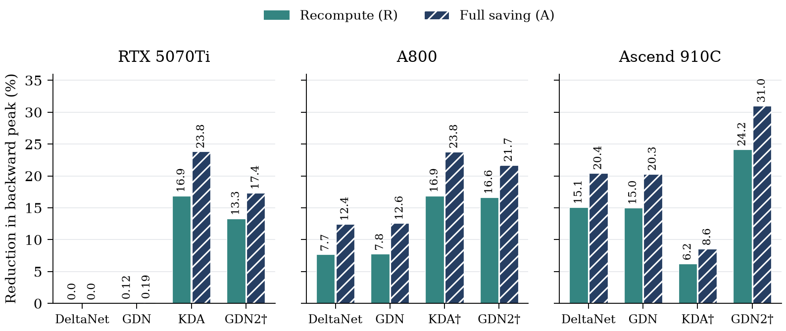
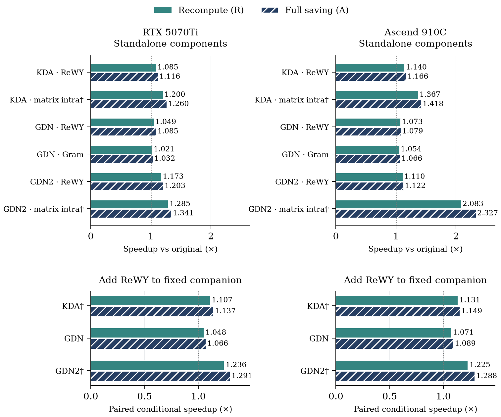
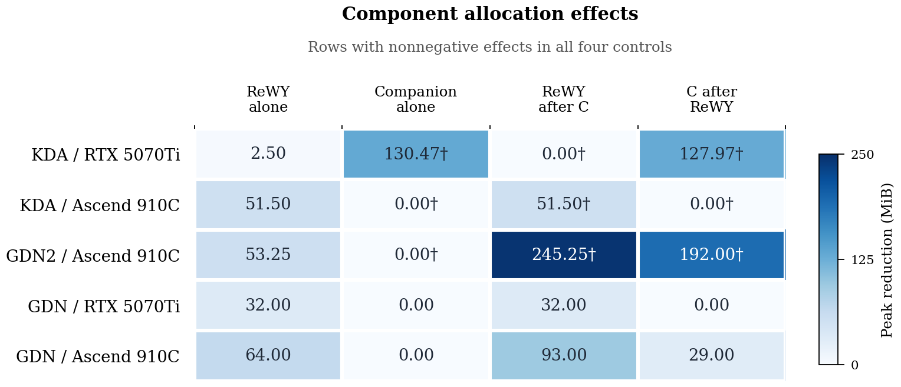

# ReWY results and measurement scope

[Homepage](../README.md#performance) · [Figure data](../benchmarks/README.md) ·
[Reproduction](reproduction.md)

These results match the November 1 paper. Residual WY reduces seven local WY
matrix products to three; state, matrix intra and final-gradient work remain.
Combined gains are not independent component effects or full-training throughput.

## Selected precision-qualified results

| Device / operator | Full-saving backward speedup | Exact source |
| --- | ---: | --- |
| RTX 5070 Ti Laptop / KDA | 1.8066× | `GPU.KDA[1]` in [paper_data.json](../benchmarks/data/paper_data.json) |
| A800 / GDN | 1.2471× | `A800.GDN[1]` in [paper_data.json](../benchmarks/data/paper_data.json) |
| Ascend 910C (`Ascend910_9382`) / GDN | 1.5142× | `NPU.GDN[1]` in [paper_data.json](../benchmarks/data/paper_data.json) |
| H100 / GDN2 | 1.7033× | `operator_results`, `gdn2/all` in [h100_data.json](../benchmarks/data/h100_data.json) |
| H200 / GDN2 | 1.6527× | `operator_results`, `gdn2/all` in [h200_data.json](../benchmarks/data/h200_data.json) |
| Ascend950DT_9582 / GDN2 | 2.894511× | `combined/gdn2/all/B` in [npu950_data.json](../benchmarks/data/npu950_data.json) |

Each entry is a six-shape geometric mean of paired median-time ratios with the
same save policy. The first five devices use complete low-level graph B including
recomputation and excluding final public-wrapper gradient conversion. 950 uses
synchronized eager public B including conversion/allocation. Different boundaries
are not pooled. [950 procedure](ascend950.zh-CN.md).

## H100 and H200 operators

| Operator | H100 R | H100 A | H200 R | H200 A |
| --- | ---: | ---: | ---: | ---: |
| DeltaNet | 1.2066× | 1.3046× | 1.1776× | 1.2697× |
| GDN | 1.2056× | 1.2829× | 1.1819× | 1.2505× |
| KDA | 1.3264× | 1.4213× | 1.3065× | 1.3964× |
| GDN2 | 1.5680× | 1.7033× | 1.5408× | 1.6527× |

R is recomputation; A is full saving. Each card has 48 configurations, 5,760
operator timings and passing embedded CPU FP64/full-gradient/graph checks. The
October 31 statefix1 cohort uses Torch 2.12.1+cu126 / Triton 3.7.1 on native
NVIDIA H100 80GB HBM3 and NVIDIA H200. Earlier L20X-alias evidence is historical.
The corrected schedule preserves original FP32 working matrices and arithmetic;
it is not a new algebraic contribution. Additional focused sanitizer checks were
not run. [Reproduction image](../containers/hopper-statefix/README.zh-CN.md).

## Full-model backward

| Fixed-architecture group | Configurations | H100 B gain | H200 B gain |
| --- | ---: | ---: | ---: |
| KDA, FLA default | 8 | +9.93% | +8.83% |
| GDN, published structure, wide64 backend | 2 | +4.48% | +4.44% |
| DeltaNet, published structure | 2 | +1.89% | +1.24% |
| GDN2, official-dimension FLA layer port | 2 | +6.51% | +5.34% |

These are the paper's groups with positive aggregate gains on both devices.
Each uses all recorded configurations, without sample filtering. The metric is
`100 * (geomean(original_B / optimized_B) - 1)` with native R, no layer checkpointing
and pure `loss.backward()` events. Each card retains 45 model configurations and
5,400 B samples across all groups. Structural exploration remains separate.
GDN2 is a FLA layer port with official dimensions, not an unchanged official model.

KDA keeps dedicated local and trajectory checks. Other families retain
performance-only full-model diagnostics: ten of eleven DeltaNet configurations
per card fail the generic trajectory diagnostic. Execution and finite-value
checks pass but do not establish original precision or convergence. Operator
checks do not substitute for model acceptance. [Model aggregates](../benchmarks/data/h100_data.json).

Earlier A800 KDA gives **+10.04%** over eight fixed-architecture input configurations.
[e2e_data.json](../benchmarks/data/e2e_data.json) describes 21 A800/9382 runs and their B
aggregates. Minimal timing samples are retained as regression fixtures, not full
machine logs or archives. Device protocols, official structures, FLA ports and structural
exploration remain distinct.

## Memory, components and display selection

The six-device figure contains 46 measured values, with no unmeasured placeholders.
Memory and component evidence covers the original three devices. Historical **†**
entries lowered existing FP32 intermediates and are excluded from precision-qualified
claims.

### Memory

Memory is incremental backward peak allocation including returned gradients at
B=1, T=8192, H=16, K=V=128. Historical KDA/9382 native controls also require a
resident 16 MiB workspace per stream, separately reported. The **†** precision
markers still apply.

### Component ablations

Independent and conditional component gains use different paired controls; do not add speedups
or count a combination as an independent contribution.
In the memory panel, C means Matrix Intra for KDA/GDN2 and Gram Elimination for
GDN; positive values mean memory saved.

Displayed results follow the paper's positive-gain scope; component-memory rows
require four nonnegative effects. Aggregates are not new measurements.
[Presentation policy](../benchmarks/data/presentation_scope.json) ·
[Exact plotted values](../benchmarks/data/figure_data.json).

## Container evidence

The [statefix1 image](../containers/hopper-statefix/README.zh-CN.md) corresponds to
the Hopper cohort. A800/9382 image packaging checks were separate from frozen
paper timings and did not rerun all models. October 30 images retain their archived replay data; the current
checkout's CPU plotting command renders the latest paper.
